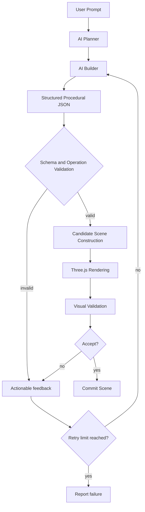

# Threepod – AI Procedural 3D Modeling System

> Turn natural-language descriptions into validated, procedurally generated 3D objects.

Threepod is a final-year engineering project that makes 3D modeling more accessible. A user types an instruction such as *"Create a wooden table with four legs and a rectangular tabletop"*. The system plans the required steps, produces structured procedural modeling operations (JSON), builds a candidate 3D scene, renders it with Three.js, and validates the result before accepting it.

> **Documentation status legend**
> ✅ Implemented  |  🧪 Experimental  |  🗓️ Planned  |  ⚠️ **Verify against the repository before publishing**
>
> This README was written from the project design description. Items marked ⚠️ must be confirmed against the actual source code.

---

## Table of Contents

1. [Overview](#overview)
2. [Key Features](#key-features)
3. [System Architecture](#system-architecture)
4. [AI Models](#ai-models)
5. [Procedural JSON Schema](#procedural-json-schema)
6. [Supported Modeling Operations](#supported-modeling-operations)
7. [Technology Stack](#technology-stack)
8. [Prerequisites and Requirements](#prerequisites-and-requirements)
9. [Installation and Setup](#installation-and-setup)
10. [Deployment](#deployment)
11. [Project Directory Structure](#project-directory-structure)
12. [End-to-End Workflow Example](#end-to-end-workflow-example)
13. [Screenshots and Demo](#screenshots-and-demo)
14. [Troubleshooting](#troubleshooting)
15. [Future Scope](#future-scope)
16. [Contributing](#contributing)
17. [License](#license)

---

## Overview

| | |
|---|---|
| **Project name** | Threepod – AI Procedural 3D Modeling System |
| **Type** | AI-powered procedural 3D modeling application |
| **Goal** | Convert natural-language instructions into structured procedural 3D modeling operations, generate and render the 3D object, and validate it before accepting it |

**Why structured operations instead of raw geometry?** The AI never outputs meshes directly. It outputs a small, well-defined set of modeling operations in JSON. This makes results checkable, repeatable, and easy to correct when something goes wrong.

---

## Key Features

| Feature | Status |
|---|---|
| Natural-language-to-3D generation | ⚠️ Verify |
| AI-based planning of modeling steps | ⚠️ Verify |
| Structured procedural JSON output | ⚠️ Verify |
| JSON schema and operation validation | ⚠️ Verify |
| Primitive-based geometry (box, sphere, cylinder, cone, torus) | ⚠️ Verify |
| Incremental scene construction | ⚠️ Verify |
| Candidate scene validation (previous accepted scene stays untouched) | ⚠️ Verify |
| Visual validation using a vision-language model | ⚠️ Verify (🧪 or 🗓️ if not complete) |
| Error feedback and retry loop | ⚠️ Verify |
| Interactive 3D visualization (Three.js) | ⚠️ Verify |

> Replace each "⚠️ Verify" with ✅, 🧪, or 🗓️ once checked against the code.

---

## System Architecture



### Stage-by-stage

1. **User input** – The user describes the desired object in plain language.
2. **Planner** – Interprets the request, determines which parts and operations are needed, and produces an execution plan.
3. **Builder** – Converts the plan into structured JSON that follows the project's procedural schema.
4. **Schema and operation validation** – Checks the JSON for correct structure, required fields, supported operation types, valid parameters, and valid object properties.
5. **Candidate scene construction** – Applies the operations to a *candidate* scene. The previously accepted scene is not modified at this point.
6. **3D rendering** – The candidate scene is rendered with Three.js.
7. **Visual validation** – The rendered result is inspected to check that it matches the requested description.
8. **Accept / reject and retry** – On success, the candidate becomes the accepted scene. On failure, actionable feedback goes back to the builder, which corrects the failed operation. Retries stop at the configured retry limit (⚠️ state the actual limit and where it is configured).

---

## AI Models

| Role | Model explored in design | Input | Output | Status |
|---|---|---|---|---|
| Planner | DeepSeek-R1 7B | User prompt | Modeling plan | ⚠️ Verify exact configured model |
| Builder | Qwen 2.5 | Plan (and validation feedback on retry) | Procedural JSON | ⚠️ Verify exact configured model |
| Visual validator | Qwen vision-language model | Rendered image + original request | Accept/reject with feedback | ⚠️ Verify exact configured model |

> The models above are the ones explored in the project design. Confirm the exact model names and sizes in the configuration files. No custom training or fine-tuning is claimed in this README. ⚠️ Add a note here only if the repository provides evidence of fine-tuning.

---

## Procedural JSON Schema

Structured JSON is used because it can be validated automatically, replayed deterministically, and consumed directly by the renderer. Schema validation rejects invalid instructions (unknown operations, missing fields, bad parameters) before anything is drawn.

> ⚠️ **Not yet documented:** The exact schema fields. Paste the real schema file contents here, and include one valid example taken directly from the repository. The example below is illustrative only and **must be replaced**.

```json
{
  "_note": "ILLUSTRATIVE PLACEHOLDER – replace with a real example from the schema",
  "operations": [
    { "op": "create_box", "params": { "...": "..." } }
  ]
}
```

---

## Supported Modeling Operations

Approved operation set (⚠️ verify each is implemented before keeping it in this table):

| Operation | Purpose | Status |
|---|---|---|
| `create_box` | Create a box primitive | ⚠️ Verify |
| `create_sphere` | Create a sphere primitive | ⚠️ Verify |
| `create_cylinder` | Create a cylinder primitive | ⚠️ Verify |
| `create_cone` | Create a cone primitive | ⚠️ Verify |
| `create_torus` | Create a torus primitive | ⚠️ Verify |
| `translate` | Move an existing object | ⚠️ Verify |
| `scale` | Resize an existing object | ⚠️ Verify |
| `duplicate` | Copy an existing object | ⚠️ Verify |

> Add a small JSON example per operation using the real parameter names from your schema.

---

## Technology Stack

> Only list technologies actually used in the repository. The entries below are the ones named in the project description; delete any that are not used and add any that are missing.

| Category | Technologies |
|---|---|
| Programming languages | ⚠️ e.g. Python, JavaScript/TypeScript |
| Frontend | ⚠️ e.g. React, Vite |
| Backend | ⚠️ e.g. Python web framework |
| AI models | DeepSeek-R1 7B, Qwen 2.5, Qwen vision-language models (⚠️ confirm) |
| 3D rendering | Three.js (WebGL) |
| Data formats | JSON |
| Validation | JSON Schema (⚠️ confirm library) |
| Development tools | ⚠️ e.g. Git, npm, pip |

---

## Prerequisites and Requirements

> ⚠️ Confirm every version and requirement against `package.json`, `requirements.txt`, and your local setup.

**Software**

- Git
- Node.js and npm (⚠️ minimum version)
- Python (⚠️ minimum version) and pip
- A modern browser with WebGL support (Chrome, Edge, Firefox)
- A way to run the AI models (⚠️ e.g. a local model runner, or an API provider; specify which one the project uses)

**Hardware (for running models locally, if applicable)**

- ⚠️ State the RAM / GPU / disk requirements for the models you use.

**Accounts / API keys**

- ⚠️ List any required keys. Never commit real credentials.

---

## Installation and Setup

> ⚠️ Commands below are the typical pattern. Replace folder names, scripts, ports, and variable names with the real ones from the repository.

### 1. Clone the repository

```bash
git clone <your-repository-url>
cd <repository-folder>
```

### 2. Configure environment variables

Create a `.env` file (⚠️ location and variable names to confirm). Use placeholders; never commit real keys.

```env
# Example only – replace with the real variable names
MODEL_ENDPOINT=<your-model-endpoint>
API_KEY=<your-api-key-if-required>
```

Add `.env` to `.gitignore`.

### 3. Backend setup

```bash
cd <backend-folder>
python -m venv venv
# Windows: venv\Scripts\activate
# macOS/Linux: source venv/bin/activate
pip install -r requirements.txt
<command-to-start-backend>
```

### 4. Frontend setup

```bash
cd <frontend-folder>
npm install
npm run dev
```

### 5. Open the app

Visit `http://localhost:<port>` in your browser (⚠️ confirm the port, commonly 5173 for Vite).

---

## Deployment

> ⚠️ Fill in according to how you actually plan to deploy. A typical procedure:

1. **Build the frontend**
   ```bash
   cd <frontend-folder>
   npm run build
   ```
   This outputs static files (⚠️ usually `dist/`).
2. **Deploy the frontend** to a static host (e.g. Netlify, Vercel, GitHub Pages) by pointing it to the build output.
3. **Deploy the backend** to a server or cloud platform that can run Python, with the same environment variables set in the host's secret settings.
4. **Provide model access.** Large models usually need a GPU server or a hosted API. Ensure the deployed backend can reach the model endpoint.
5. **Configure CORS / API URL** so the deployed frontend points to the deployed backend (⚠️ name the config setting).
6. **Verify** by submitting a test prompt and confirming a rendered object appears.

---

## Project Directory Structure

> ⚠️ **Not yet documented.** Generate the real tree and paste it here, for example on macOS/Linux with `tree -L 2 -I "node_modules|venv|.git"`, or on Windows with `tree /F`.

```text
<repository-root>/
├── <frontend>/     # 3D viewer and user interface
├── <backend>/      # Planner/builder orchestration, validation, retry logic
├── <schema>/       # Procedural JSON schema
└── README.md
```

---

## End-to-End Workflow Example

**Prompt:** *"Create a table with four legs and a rectangular top."*

1. **User** enters the prompt in the interface.
2. **Planner** determines that the table needs one flat rectangular top and four vertical legs positioned at the corners.
3. **Builder** emits procedural JSON using the supported operations (for instance a box for the top, a cylinder or box for a leg, then `duplicate` and `translate` for the remaining legs). ⚠️ Replace with the real output.
4. **Validator** checks structure, operation names, and parameters.
5. **Candidate scene** is built, leaving the last accepted scene untouched.
6. **Three.js** renders the candidate.
7. **Visual validator** checks that the render looks like a table with four legs and a top.
8. **Accept** and commit the scene, or **reject** with feedback so the builder can fix the problem and retry (up to the retry limit).

---

## Screenshots and Demo

> ⚠️ **Not yet added.** Place images in a folder such as `docs/images/` and reference them with relative paths:
>
> ```markdown
> 
> ```

| Screenshot | Description |
|---|---|
| *(to be added)* | Main interface |
| *(to be added)* | Generated table |
| *(to be added)* | Validation / retry feedback |

---

## Troubleshooting

| Problem | Likely cause / fix |
|---|---|
| Blank 3D canvas | Browser lacks WebGL, or the frontend can't reach the backend. Check the console. |
| Model returns invalid JSON | Schema validation will reject it; the retry loop should correct it. Check model configuration. |
| Backend connection errors | Confirm the backend is running and the API URL/port in the frontend config matches. |
| Missing dependency errors | Re-run `npm install` / `pip install -r requirements.txt`. |

---

## Future Scope

These are future possibilities, **not** current features unless marked above:

- More advanced 3D primitives
- Complex object generation
- Improved spatial reasoning
- Better visual validation
- More sophisticated procedural operations
- Improved model performance
- Export to GLB, GLTF, and OBJ
- Better interactive editing

---

## Contributing

Contributions are welcome.

1. Fork the repository
2. Create a branch: `git checkout -b feature/your-feature`
3. Commit your changes: `git commit -m "Add your feature"`
4. Push: `git push origin feature/your-feature`
5. Open a Pull Request describing your change

---

## License

⚠️ No license is documented yet. Add a `LICENSE` file (e.g. MIT) and update this section. Until then, do not claim any license.

---

## Authors

⚠️ Add your name, team members, guide/supervisor, and institution.
